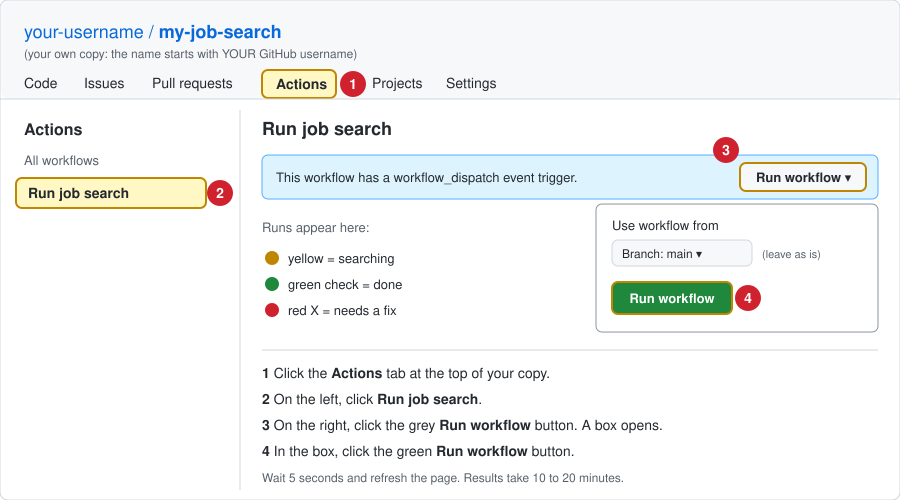

# How to run a search right now

Automatic weekly searches start **off**, so this is how you get results: start a search
yourself, any time. (To have searches run by themselves every week, choose On in the setup questionnaire, or see SETUP.md, Step 6.)
It takes about 10 to 20 minutes and runs on GitHub, so you can close the page while it works.

## Before you start: do these 2 things first

A search will **not** work until both are done:

| | Must be done first | How |
|---|---|---|
| ☐ | **1. You made your own copy** of this project, and you are signed in to GitHub. You cannot run a search in the original shared project. | [SETUP.md](SETUP.md), Step 1 |
| ☐ | **2. You saved at least one job title** with the setup questionnaire. | [SETUP.md](SETUP.md), Step 2 |

If you skip step 2, the search stops right away with the message **"NO JOB TITLES SET YET"**.

## Steps

### The quick way

Open **your copy** on github.com, then click this link:

**[START A SEARCH NOW: open the "Run job search" page](../../actions/workflows/run_job_search.yml)**

It opens the page in the picture below. Then do steps 3 and 4 in the picture.
(The link only works in your own copy, while you are signed in.)

### The picture: where to click

### The same steps in words

1. Go to **your copy** of the repository on github.com. The name at the top left starts
   with your GitHub username.
2. Near the top of the page, in the row of tabs (**Code**, **Issues**, **Pull requests**,
   **Actions** ...), click **Actions**.
   **First time only:** if you see a green button that says
   **"I understand my workflows, go ahead and enable them"**, click it.
3. On the left side of the page, under "All workflows", click **Run job search**.
4. On the right side, in the light blue bar, click the grey **Run workflow** button.
   A small box opens.
5. In that box, leave "Use workflow from: Branch: main" as it is, and click the green
   **Run workflow** button.
6. Wait about 5 seconds, then refresh the page. A new line appears at the top of the list
   with a yellow circle (searching).
7. When it finishes (10 to 20 minutes), the yellow circle becomes:
   a. **a green check mark:** the search worked. Go to "See the results" below.
   b. **a red X:** something needs fixing. Go to "If you see a red X" below.

## See the results

1. **Right away:** click the finished search (the line with the green check). Its results
   are shown on that page.
2. **Any time:** click the **Code** tab, then open the **JOB_SEARCH_RESULTS** folder. Its main
   page shows your latest results:
   a. jobs that match all your rules, with **Apply** links,
   b. near misses (did not meet one of your rules) and the reason,
   c. jobs whose link could not be checked, with a **Find employer posting** link.
3. Below that is the list of reports, one per search, newest first, for example
   `REPORT_001_2026-11-06_13-47_UTC.md` (search number, date, time in UTC). Open one to see
   the jobs found in that search: matches, jobs that need checking, and near misses.
4. A search with nothing new still adds a report.

## If you see a red X

1. Click the line with the red X.
2. Click the step with the red X next to it (usually **Check settings files**).
3. Read the message. The most common ones:
   a. **"NO JOB TITLES SET YET"**: answer the setup questionnaire (Issues tab, New issue,
      Job search setup) with at least one job title.
   b. **"SETTINGS PROBLEM"**: answer the setup questionnaire again; the message says which answer
      to fix.
4. After fixing, start again with the **START A SEARCH NOW** link above.

## If you don't see a "Run workflow" button

1. Make sure you are in **your own copy**, not the shared template. The repository name at
   the top left should start with your GitHub username.
2. Make sure you clicked **Run job search** on the left (step 3).
3. If the Actions tab is missing, open **Settings** > **Actions** > **General**, choose
   **Allow all actions and reusable workflows**, click **Save**, and try again.
