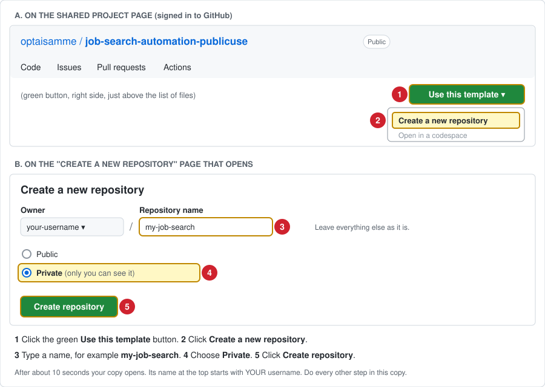

# Setup Guide (no coding needed)

This tool searches public job listings when you start a search, checks each job against your
rules (location, salary, required experience and certifications), checks that the application
link works, and saves the results in your copy. Automatic weekly searches are off until you
turn them on (Step 6). It runs on GitHub's computers, so your own computer does not need to be
on. Everything is edited on the GitHub website.

## What you need

1. A free GitHub account: https://github.com/signup
2. About 30 minutes for first-time setup.

## Step 1: Make your own copy



1. Open the shared project page (the link you were given).
2. Click the green **Use this template** button, then **Create a new repository**.
   (If you don't see that button, ask the person who shared it to give you access.)
3. Name it, for example, `my-job-search`.
4. Choose **Private**. Your settings and job search results are saved in your copy; in a public copy,
   anyone can read them.
5. Click **Create repository**.

You never need to edit a file: all your settings are made with the setup questionnaire (Step 2).

## Step 2: Set your search rules (required)

1. In **your copy**, click the **Issues** tab, then the green **New issue** button. A list of
   forms opens (or use this link while in your copy: [open the questionnaire list](../../issues/new/choose)).
   Click **Job search setup**. If a blank "Create new issue" page opens instead, click
   **Choose a different template** near the top, then **Job search setup**.
2. Answer the questions. Only "Job titles to look for" is required. Leave a question empty to
   leave that setting off.
3. Click **Create** (on some screens it says **Submit new issue**). GitHub shows your answers on a new
   page; stay there. Within a minute or two a reply appears at the bottom (refresh if it does not). It
   lists what was saved, or explains what to fix (edit the issue to fix it; it is checked again).
4. If you chose to start a search, the reply begins with **Click here to watch it**. Any time, to
   see searches: click the **Actions** tab at the top of your copy, then **Run job search** on the left. A yellow dot means a search is running; a green check means it finished.
5. If there is no **Issues** tab: click **Settings**, then **General**, scroll to **Features**,
   and tick **Issues**.
6. Only you, and people you added as collaborators, can change your settings this way.

Each search starts with a step called "Check settings files" that lists exactly what is ON and
OFF. If no job titles are saved, the search stops there and says so.

## Step 3: Add your experience (optional)

In the questionnaire, Step 6 "About you": your skills, your years of experience and the
certifications you hold. Include only things you have actually done; no phone, email or address.
Your skills never remove a job. They show how well each job fits you, and skills-based matching
uses them to find jobs with other titles. This step can stay empty.

## Step 4: Run your first search

Only after Steps 1 and 2 are done (your own copy, and at least one job title saved), follow
**[HOW_TO_RUN_A_SEARCH_NOW.md](HOW_TO_RUN_A_SEARCH_NOW.md)** once. Enabling the
workflow there (its step 2) lets you start searches. Use the same guide any time you want
new results.

**Automatic weekly searches stay OFF** until you turn them on (Step 6, item 1).

## Step 5: Where to see your results

Open the **JOB_SEARCH_RESULTS** folder in your repository (on the **Code** tab).

1. **The folder's main page** opens automatically and shows your **latest results**:
   a. **Jobs that match all your rules**, with an **Apply** link for each.
   b. **Near misses:** jobs that did not meet one of your rules, and which rule.
   c. **Jobs whose link could not be checked**, with a **Find employer posting** link.
2. **One numbered report per search**, for example `REPORT_001_2026-11-06_13-47_UTC.md`
   (search number, date, time in UTC). The newest is listed first. Each report lists the
   jobs found in that search: matches, jobs that need checking, and near misses.
3. **Actions tab:** green check = the search worked; click it to see its results. Red X =
   click it, then the red step, to read what to fix.
4. The **first search** shows all jobs that already match. After that, each job is shown
   as new only once. A search with nothing new still adds a report to the folder.

## Step 6: Optional changes

1. **Turn on automatic weekly searches (they start OFF):**
   a. In the setup questionnaire, choose **On** for "Automatic weekly searches" and pick a day.
   b. The search starts around 13:47 UTC on that day (about 6:47 AM Mountain in winter, 7:47 AM
      in summer).
   c. Once a day, GitHub starts a quick check to see whether today is your day. On other days,
      and while weekly searches are off, it stops after a few seconds without searching. The
      Actions tab shows those as short runs with the search skipped.
2. **Free web search key (recommended).**
   Without a key, every search already checks 7 job sites and company careers pages. Adding
   one free key turns on a **web search**: for each of your job titles, the tool also searches
   the whole web, including company careers pages, and finds jobs that are on no job site. It
   also finds new companies to check. It is optional and stays off until you add the key.

| Service | What it adds | Where to get the free key | Secret name to add |
|---|---|---|---|
| **Tavily** (web search) | Searches the whole web for each of your job titles, including company careers pages | https://app.tavily.com: on the log-in page that opens, click **Sign up** (or continue with a Google, GitHub, LinkedIn or Microsoft account). After signing in, copy your API key from your Tavily account page (it starts with `tvly-`) | `TAVILY_API_KEY` |

   **Free plan:** 1,000 web searches a month. This tool uses 2 web searches for each of your job
   titles, plus 2 for skills-based matching when it is on. For example, 5 job titles use 10 web
   searches per search, about 45 a month with weekly searches. If the free searches run out, the
   rest of each search still runs.

   **How to add the key:**

   1. Sign up at https://app.tavily.com and copy your API key (see the table).
   2. Open **your copy** of this project on github.com.
   3. Click **Settings** (top row of tabs, far right).
   4. On the left, click **Secrets and variables**, then **Actions**.
   5. Click the green **New repository secret** button.
   6. In **Name**, type `TAVILY_API_KEY` exactly (capital letters and underscores included).
      In **Secret**, paste the key. Click **Add secret**.
   7. Start a search. In the report, under "Where this search looked", the Web search (Tavily)
      row shows **Yes** in "Searched this time?" when it worked. **Off: no key** means the secret
      is missing or misspelled. **No: error** means the key was not accepted.

   The key is private: only you can see it, and it is never shown in results. To remove it,
   open the same page and click the trash icon next to it.

   **Boards that do not offer keys:** LinkedIn, Indeed, Handshake, Idealist and the other popular
   boards on your results page offer no key for automated searching. Use the one-click search
   links on the results page for those.

## When you change your settings later

1. Open the **JOB_SEARCH_RESULTS** folder and click **click here to change these settings** (under
   "Your settings"). The questionnaire opens with your current text answers filled in. Change only what
   you want, then click **Create**:
   a. A text box left empty turns that setting off.
   b. A dropdown left on "None" keeps its current choice.
   Changes take effect on the next search (weekly if turned on, one the questionnaire starts, or one you
   start with [HOW_TO_RUN_A_SEARCH_NOW.md](HOW_TO_RUN_A_SEARCH_NOW.md)).
2. Jobs still listed online are re-checked: a job that now passes is shown as
   **Newly verified (seen before)**. A job that now fails one rule is listed under Near Misses
   in the next report; jobs that fail 2 or more rules are only counted in the totals. Jobs
   already shown as new are never shown as new again.
3. To start over completely, delete `data/jobs.sqlite`; the next run is treated as a first
   run again.

## What it does not do

1. It never applies to jobs or contacts employers.
2. It does not search LinkedIn, Indeed, Handshake, Idealist and the other popular boards on
   the results page (no public data feed, sign-in required, or their terms do not allow it).
   The results page has one-click search links for them instead.
3. It searches Himalayas, The Muse, Remote OK, Jobicy, We Work Remotely, Remotive,
   Hacker News "Who is hiring?", and the careers pages of companies you
   add in the questionnaire or that it found earlier. It searches the wider web only if you
   add the free Tavily key.
4. Results come from text rules. When a posting is unclear, the job is listed under "Jobs
   that need checking" rather than guessed, so read each posting yourself before applying.

## Running it on your own computer instead (optional)

1. Install Python 3.11 or newer: https://www.python.org/downloads/
2. Download your repository (green **Code** button, **Download ZIP**) and unzip it.
3. Open a terminal in that folder and run:

```bash
python3 -m jobsearch check
```

```bash
python3 -m jobsearch run
```

4. Results are written to the `JOB_SEARCH_RESULTS` folder.
